# Shelf

<strong>A private, local-first EPUB reader for Android.</strong>

  <a href="https://github.com/Vengeful-Pancake/ShelfAndroid/releases/latest/download/Shelf-v0.1.apk"><strong>Download Shelf 0.1</strong></a>
  &nbsp;|&nbsp;
  Android 8.0 or newer
  &nbsp;|&nbsp;
  No account required

  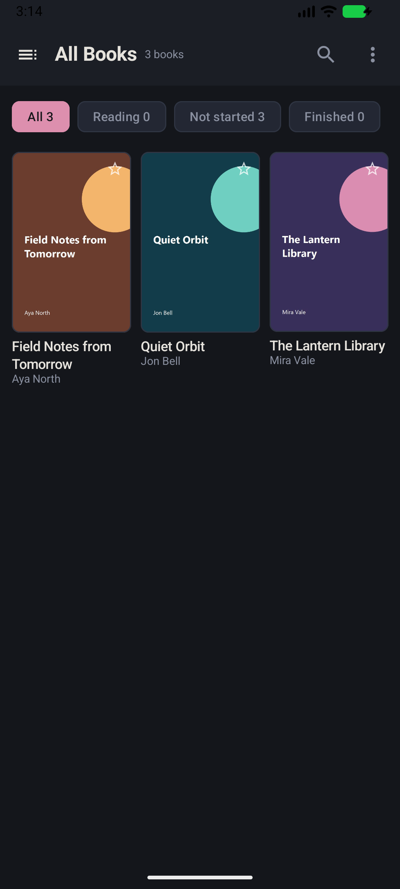
  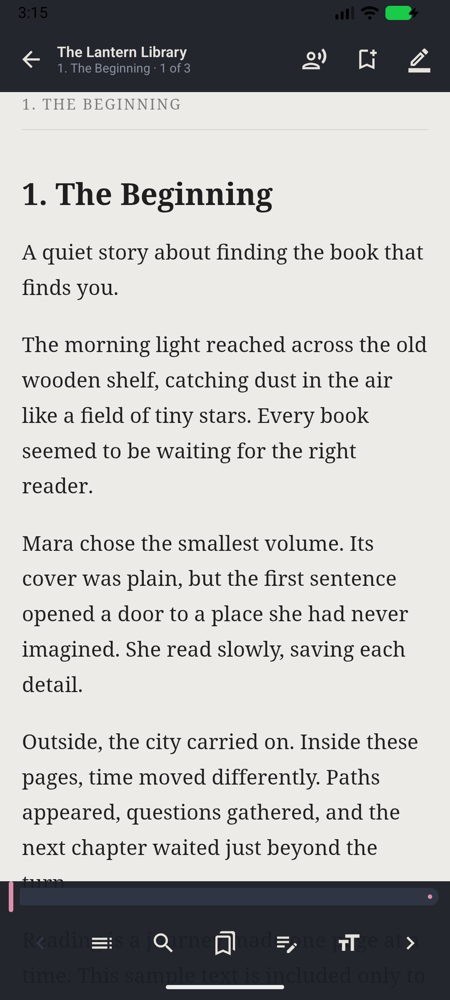
  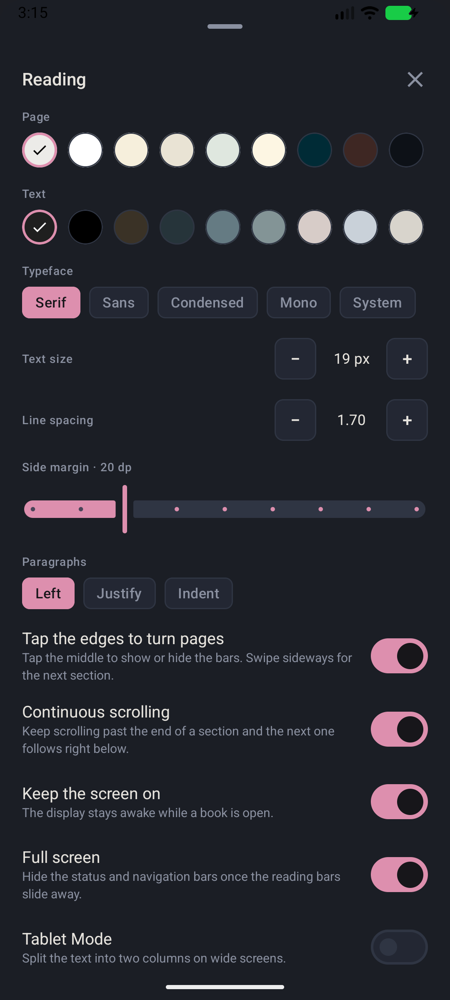

Shelf reads the `.epub` books already on your phone, tablet, SD card, USB drive,
or any storage location exposed by Android's file picker. Your books, reading
position, bookmarks, highlights, and notes stay on your device unless you
choose to export them.

> The sample book covers and text in these screenshots are demonstrations for
> this guide. Shelf does not include copyrighted books or download books by
> itself.

## Download and install

1. Download [`Shelf-v0.1.apk`](https://github.com/Vengeful-Pancake/ShelfAndroid/releases/latest/download/Shelf-v0.1.apk).
2. Open the downloaded APK on your Android device.
3. If Android asks, allow your browser or file manager to **Install unknown
   apps**, then return to the installer.
4. Tap **Install**, then open Shelf.

Installing a later Shelf release over 0.1 keeps your library and reading data.
Do not uninstall the app first unless you have made a backup; Android normally
removes an app's private data when it is uninstalled.

## Start your library

  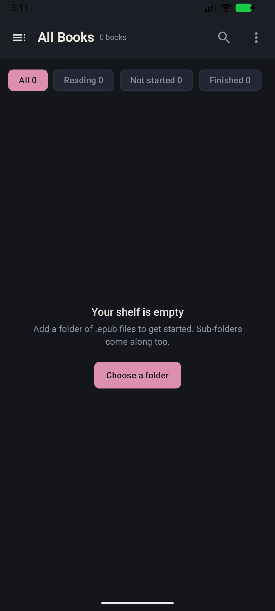
  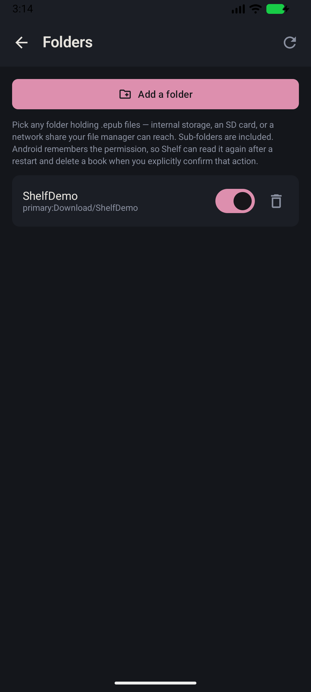

1. Tap **Choose a folder** on the empty-library screen. You can also open
   **More (three dots) -> Folders -> Add a folder** later.
2. In Android's folder picker, open a folder containing `.epub` files and tap
   **Use this folder**.
3. Confirm the access request. Shelf scans that folder and its subfolders, then
   shows the books it finds.

Shelf remembers the folder permission after a restart. Add as many folders as
you need. Internal storage, SD cards, USB storage, and storage-provider apps are
supported. For an SMB/NAS/network folder, first expose the share through an
Android file-manager or document-provider app; Android cannot select a raw UNC
path directly.

### Folder screen controls

| Control | What it does |
|---|---|
| **Add a folder** | Opens Android's folder picker and adds another source. |
| Circular **rescan** arrow | Rechecks every enabled folder immediately. |
| Pink switch | Enables or disables that source in Shelf. The EPUB files themselves are not changed. |
| Trash can beside a folder | Makes Shelf forget that source and its indexed books; the actual EPUB files stay in the folder. |

Shelf normally performs a quick incremental scan, so unchanged books do not
need to be parsed again. **Rescan folders** is useful after copying, renaming,
editing, or deleting EPUB files outside Shelf.

## Library screen

### Top bar and filters

| Control | What it does |
|---|---|
| Three-line **library** button | Opens folders, detected series, duplicate books, and your custom libraries. |
| **Search** | Finds books by title, author, filename, folder, or series. |
| Three-dot **More** button | Opens sorting, display, backup, settings, browser, catalogue, folder, and rescan tools. |
| **All** | Shows every book in the selected library/category. |
| **Reading** | Shows books you have started but not finished. |
| **Not started** | Shows books without a saved reading position. |
| **Finished** | Shows books at 98% progress or later. |

The number on each filter is the number of matching books. A progress line on a
book card shows how far you have read.

### Book cards

| Action | Result |
|---|---|
| Tap a cover/card | Opens the book at your last saved position. |
| Tap the star | Pins or unpins the book as a favourite. |
| Long-press a cover/card | Opens the complete book-details and actions panel. |
| Pull down on the library | Starts a normal rescan. |

A **Won't open** label means the EPUB is damaged, unsupported, or protected by
DRM. Shelf reads normal DRM-free EPUB 2 and EPUB 3 files; it cannot remove DRM.

### Library navigation

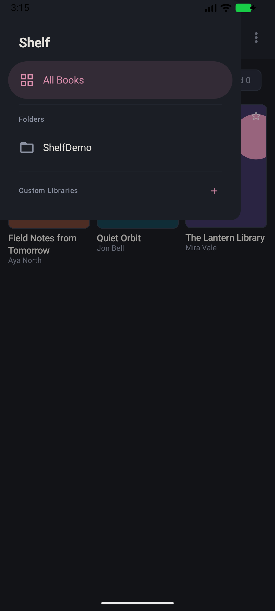

| Section | Purpose |
|---|---|
| **All Books** | Your complete indexed collection. |
| **Duplicates** | Appears when Shelf finds books with matching title/author information. |
| **Series** | Automatically groups books that contain series metadata. |
| **Folders** | Lets you view only the books from one source folder. |
| **Custom Libraries** | Named collections you create yourself. Tap the **+** to create one. |

Custom libraries do not move or duplicate EPUB files. They are simply your own
groups, such as “To Read”, “Research”, or “Favourites for the trip”.

### Book details and actions

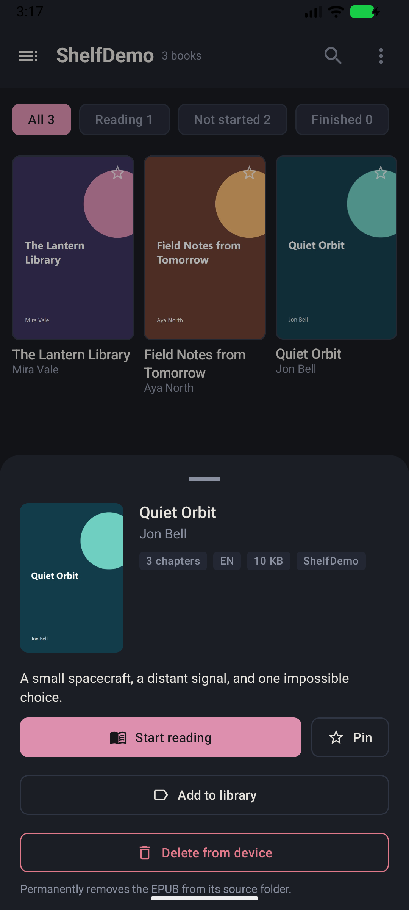

Long-press a book to see its title, author, description, series, language,
chapter count, file size, source folder, reading progress, and last-opened date.

| Action | What it does |
|---|---|
| **Start/Continue reading** | Opens the book. |
| **Pin/Pinned** | Adds or removes the favourite star. |
| **Add to library** | Adds or removes the book from one or more custom libraries. |
| **Forget my place** | Clears the saved reading position and returns the book to Not started. |
| **Delete from device** | Permanently deletes the source EPUB after confirmation, then removes its progress, bookmarks, highlights, statistics, and collection membership. |

Some storage providers initially grant read-only access. If deletion needs
write access, Shelf asks you to select the same source folder again. It never
deletes a different folder or removes the library data if the EPUB could not be
deleted.

## The More menu

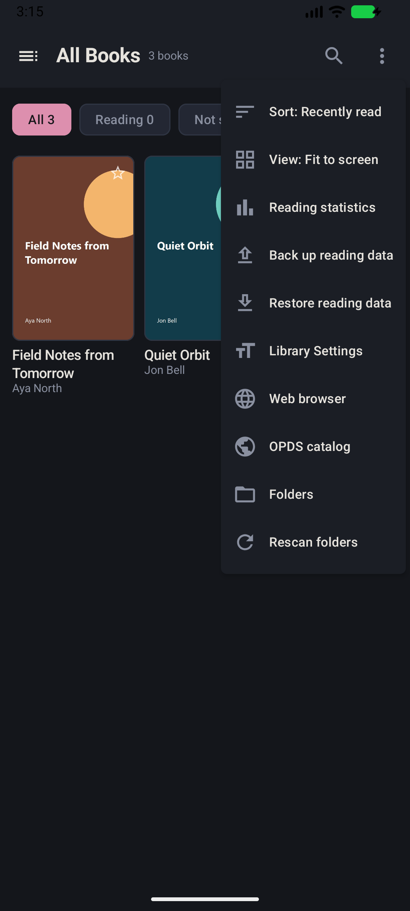

| Menu item | What it does |
|---|---|
| **Sort** | Choose Recently read, Title A-Z, Author A-Z, Newest file, or Favourites first. |
| **View** | Choose Fit to screen, Large, Medium, Small, or Tiny covers, List, or Detailed List. |
| **Reading statistics** | Shows your streak, reading time, started books, and finished books. |
| **Back up reading data** | Saves a portable JSON file containing your Shelf reading data and preferences. |
| **Restore reading data** | Replaces current reading data and preferences from a Shelf backup after confirmation. |
| **Library Settings** | Opens reader typography plus library appearance and word-replacement settings. |
| **Web browser** | Opens Shelf's optional browser and article reader. |
| **OPDS catalog** | Browses an OPDS 1 catalogue and saves selected EPUBs through Android's file picker. |
| **Folders** | Adds, enables, disables, removes, or rescans source folders. |
| **Rescan folders** | Looks for changed, added, or removed EPUBs now. |

## Reading a book

Tap the middle of the page to show or hide the control bars. Scrolling down also
gets the bars out of the way.

### Top bar

| Control | What it does |
|---|---|
| Back arrow | Saves your place and returns to the library. |
| Book title and section line | Shows the current book, section name, and section number. |
| Person/speaker | Starts or stops **Read aloud**. |
| Bookmark with **+** | Saves your exact section and position. |
| Pencil/highlighter | Saves selected text as a highlight and optionally attaches a note. |

### Bottom bar

| Control | What it does |
|---|---|
| Left arrow | Goes to the previous reading section. |
| Three-line contents icon | Opens the book's table of contents. |
| Magnifying glass | Searches every readable section in the open EPUB. |
| Bookmark icon | Lists saved bookmarks; tap one to return to it. |
| Note/pencil icon | Lists highlights and notes and exports them as Markdown. |
| **Tt** | **This is the font and reading-settings button.** It changes page/text colours, typeface, text size, spacing, margins, paragraph layout, scrolling, full screen, and more. |
| Right arrow | Goes to the next reading section. |
| Pink progress slider | Moves within the current section; release it to save the new position. |

### Reading gestures

| Gesture | Result |
|---|---|
| Tap the middle | Show or hide both reader bars. |
| Tap the left/right edge | Move one screenful backward/forward when edge turning is enabled. |
| Scroll vertically | Read normally; with Continuous scrolling enabled, the next section is appended below. |
| Swipe sideways | Offers to move to the previous/next section and asks for confirmation to avoid accidents. |
| Tap an internal book link | Jumps to its target section or heading. |
| Tap a web link | Opens it outside the protected book reader. |

Shelf saves progress while you read and again when the app pauses or you leave
the reader. Covers, title pages, contents, copyright pages, and other front
matter are kept out of the reading-progress calculation when the EPUB identifies
them clearly.

## Font, colours, layout, and library appearance

The `Tt` button shown above opens this panel:

All changes are saved automatically and applied immediately.

| Setting | What it changes |
|---|---|
| **Page** | Chooses the reading-page colour, including light, warm, green, brown, dark, and near-black choices. Shelf keeps the text readable when switching between light and dark pages. |
| **Text** | Chooses the reading-text colour. |
| **Typeface** | Selects Serif, Sans, Condensed, Mono, or the Android System font. |
| **Text size** | Changes body text from 12 to 40 px. |
| **Line spacing** | Changes line height from compact to widely spaced. |
| **Side margin** | Changes the left and right page gutter. |
| **Left** | Uses normal left-aligned paragraphs. |
| **Justify** | Aligns paragraph text to both page edges. |
| **Indent** | Toggles first-line paragraph indentation. |
| **Tap the edges to turn pages** | Enables/disables left- and right-edge page taps. Middle taps still control the bars. |
| **Continuous scrolling** | Appends the next section underneath the current one as you reach the end. |
| **Keep the screen on** | Stops the display sleeping while a book is open. |
| **Full screen** | Hides Android's status/navigation bars after Shelf's reader bars hide. |
| **Tablet Mode** | Uses two text columns on wide screens. |
| **Show filename as title** | Displays the `.epub` filename instead of the title stored inside the EPUB. |

  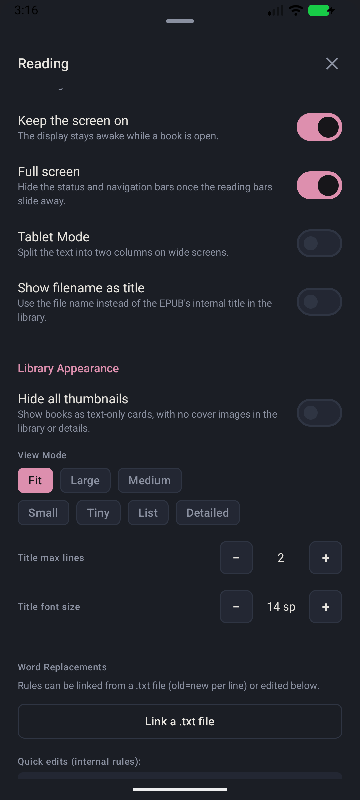
  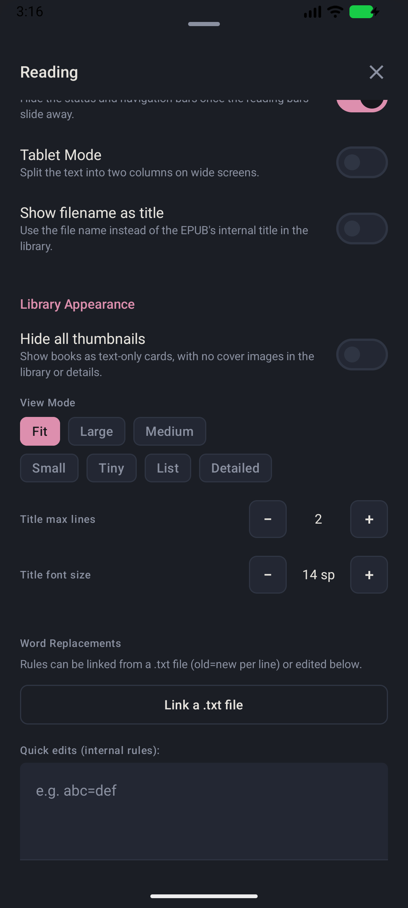

| Library/advanced setting | What it changes |
|---|---|
| **Hide all thumbnails** | Uses text-only book cards and hides cover art in the library and details. |
| **View Mode** | Selects adaptive Fit, Large/Medium/Small/Tiny covers, List, or Detailed view. |
| **Title max lines** | Controls how many lines a book title can occupy on a card. |
| **Title font size** | Changes title size in the library. |
| **Word Replacements** | Rewrites visible book/library text with `old=new` rules. Enter quick rules directly or link a `.txt` file with one rule per line. EPUB markup and image links are left alone. |

You can also open the same panel from **More -> Library Settings** without
opening a book.

## Contents, search, bookmarks, highlights, and notes

  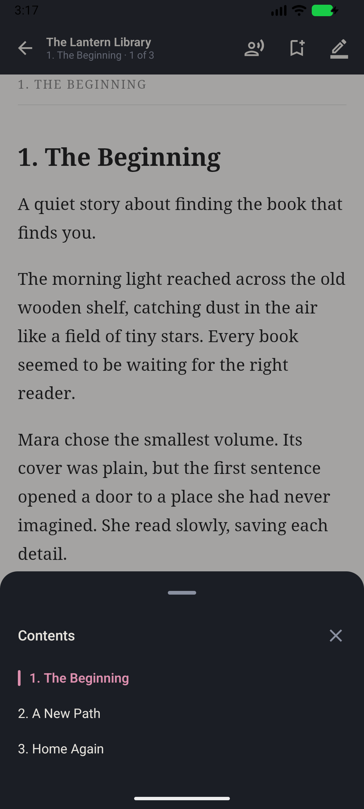
  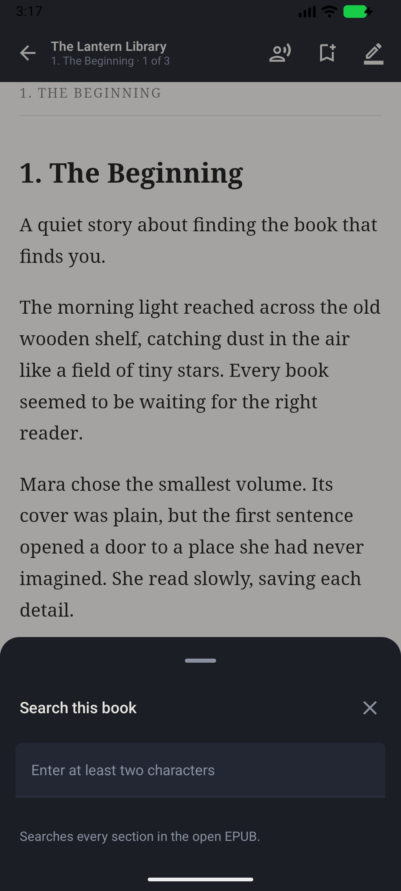
  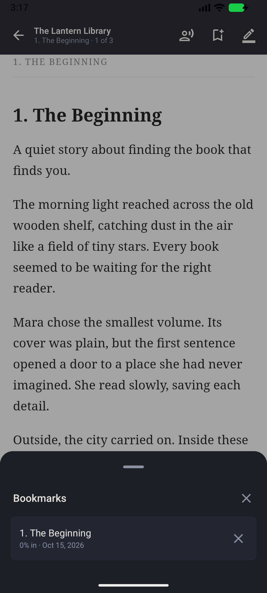
  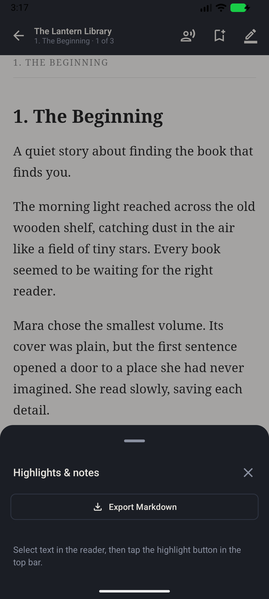

- **Contents:** uses the EPUB's navigation list and marks your current section
  in pink. Tap an entry to jump there.
- **Search:** enter at least two characters. Shelf searches the text of every
  reading section and shows the section title plus a matching excerpt.
- **Bookmarks:** tap the top bookmark button to save your position. Open the
  bottom bookmark list to revisit or remove saved positions.
- **Highlights:** select text in the page, then tap the top highlighter button.
  Shelf lets you save the quote by itself or attach an optional note.
- **Highlights & notes:** tap an item to return to it, remove it with the close
  button, or choose **Export Markdown** to save all notes for that book as a
  `.md` file.

## Read aloud

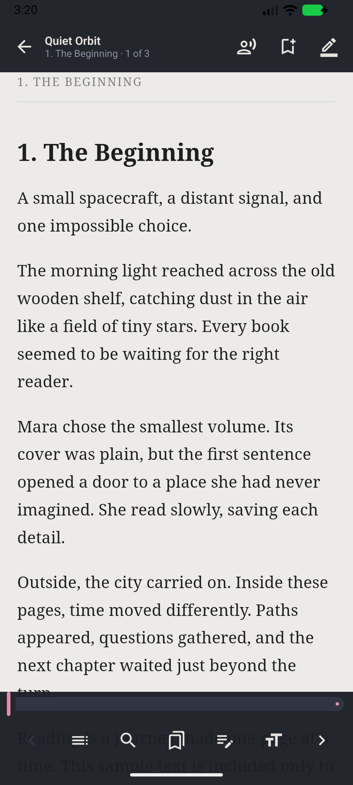

Tap the person/speaker button in the top bar to read the current section with
Android's text-to-speech engine. Shelf uses the EPUB's declared language when
possible and falls back to the device language if that voice is unavailable.

While speaking, Shelf highlights the active passage and adds these controls:

- **Voice Settings** selects from voices installed on the device.
- **0.75x, 1.0x, 1.25x, 1.5x, 2.0x** changes speaking speed.
- The speech slider jumps to another point in the spoken section.
- The top stop button ends speech immediately.

If no speech engine or suitable voice is installed, Android may ask you to add
one in the device's text-to-speech settings.

## Reading statistics

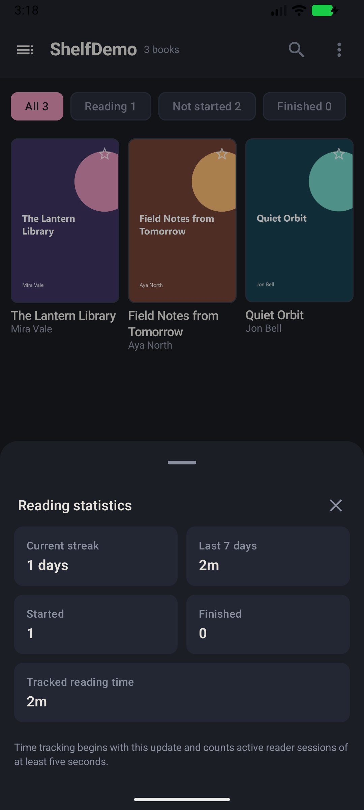

Shelf shows:

- your current reading-day streak;
- active reading time from the last seven days;
- number of started and finished books; and
- total tracked reading time.

Only active reader sessions of at least five seconds are counted. Statistics
stay on the device and are included in a Shelf backup.

## Backup and restore

Choose **More -> Back up reading data** and select where to save the JSON backup.
It contains:

- reader and library settings;
- progress and last-read positions;
- bookmarks, highlights, and notes;
- favourites and custom-library membership; and
- reading sessions/statistics.

The backup does **not** contain EPUB files or folder permissions. Keep the books
themselves backed up separately.

Choose **More -> Restore reading data** to restore a backup. Shelf first asks
for confirmation because current reading data and preferences will be replaced.
It matches backup entries to books already present in your current folders; it
does not copy or overwrite the source EPUBs.

## OPDS catalogue

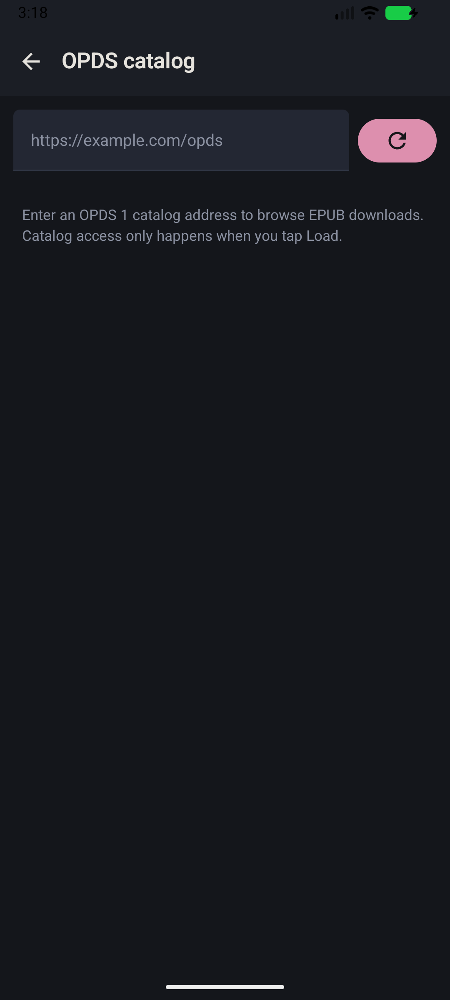

1. Open **More -> OPDS catalog**.
2. Enter an OPDS 1 catalogue address and tap **Load**.
3. Tap a listed book, then choose where Android should save the EPUB.
4. Save it inside one of Shelf's watched folders and rescan the library.

Shelf contacts the catalogue only after you tap **Load**. Prefer HTTPS catalogue
addresses. Catalogue availability, authentication, and book rights are managed
by the catalogue provider, not Shelf.

## Web browser and article reader

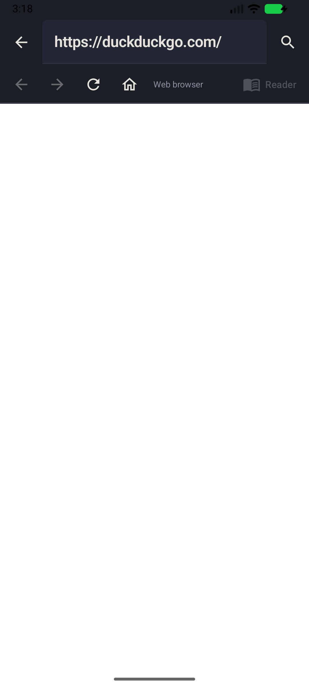

Open **More -> Web browser** to use the optional browser:

- type a web address or search phrase in the address field;
- use Back, Forward, Reload, and Home in the second toolbar; and
- tap **Reader** when available to extract the main article into a clean reading
  view.

The article reader can speak the extracted article, change speed from 0.75x to
2.0x, and seek through the speech. It is separate from the protected EPUB
reader. The browser can access the internet; opening a local EPUB does not upload
the book.

## Automatic updates

Shelf checks the latest stable release from this GitHub repository when the app
starts. If a numerically newer version is available, a dialog shows its release
notes and file size.

1. Tap **Download update** or **Later**.
2. Shelf downloads only from GitHub's HTTPS release hosts.
3. It checks that the file is an Android APK and verifies GitHub's SHA-256 digest
   when the release supplies one.
4. Android may ask once for permission to install apps from Shelf.
5. After verification, Android's normal package installer opens for the final
   confirmation.

Shelf cannot install silently, and it does not replace the app without Android's
confirmation. Offline checks remain quiet. Drafts, prereleases, malformed
versions, missing APKs, and non-GitHub download redirects are ignored or
rejected. Updates must be signed with the same key as 0.1, so Android can install
them over the existing app without erasing your data.

## Privacy and storage behaviour

- **No account:** Shelf has no sign-in and no Shelf cloud service.
- **Local library:** EPUB files remain in the folders you selected.
- **Private reading data:** progress, bookmarks, notes, settings, cover cache,
  and statistics are stored in the app's private data unless you export them.
- **Protected EPUB reader:** publisher scripts, remote frames, event handlers,
  and publisher CSS are removed. Book resources are loaded only from the open
  EPUB. External web links open only after you tap them.
- **Optional network features:** GitHub update checks, OPDS catalogues, and the
  web browser use the network. Ordinary local reading does not require it.
- **Deletion is explicit:** only **Delete from device** removes a source EPUB,
  and Shelf shows a confirmation first.

## Supported books and common questions

### What can Shelf open?

Shelf supports DRM-free `.epub` files, including EPUB 2/EPUB 3 navigation,
covers, metadata, internal images, and large ZIP64 archives. PDF, MOBI, AZW,
Kindle DRM, Adobe DRM, and audiobook formats are not supported in 0.1.

### Why is a book missing?

Make sure the filename ends in `.epub`, its folder is enabled, and Android still
grants Shelf access. Then use **More -> Rescan folders**. A damaged or protected
book may appear with **Won't open** instead.

### Why can Shelf not see my network share?

Android's picker can show only locations exposed by installed storage-provider
apps. Connect the share in a compatible file manager first, then choose it from
Shelf's folder picker.

### Does removing a folder delete my books?

No. Removing a source from the Folders screen only makes Shelf forget that
source. **Delete from device** in a book's detail panel is the action that
permanently deletes an EPUB.

### Where should I report a problem?

Open a [GitHub issue](https://github.com/Vengeful-Pancake/ShelfAndroid/issues)
and include your Android version, Shelf version, what you tapped, and what you
expected. Do not attach a copyrighted book; describe its source and whether it
uses DRM instead.

---

Shelf 0.1 is the first public release. See all downloads and release notes on
the [Releases page](https://github.com/Vengeful-Pancake/ShelfAndroid/releases).
